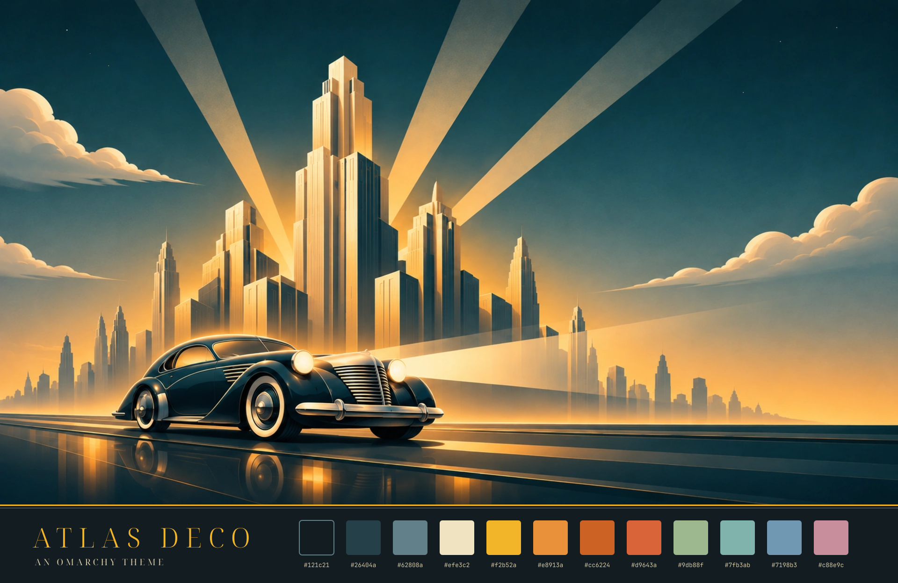
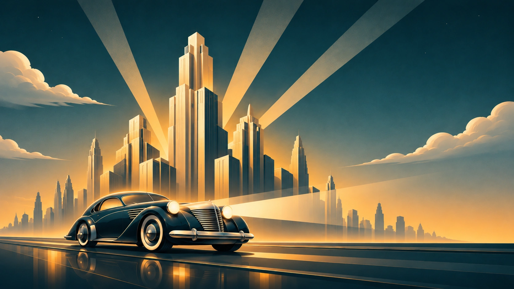
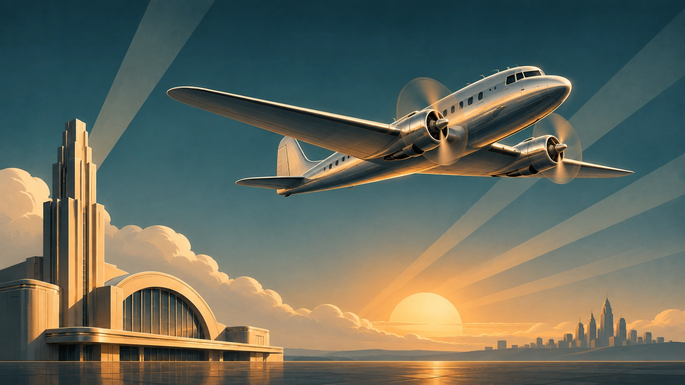
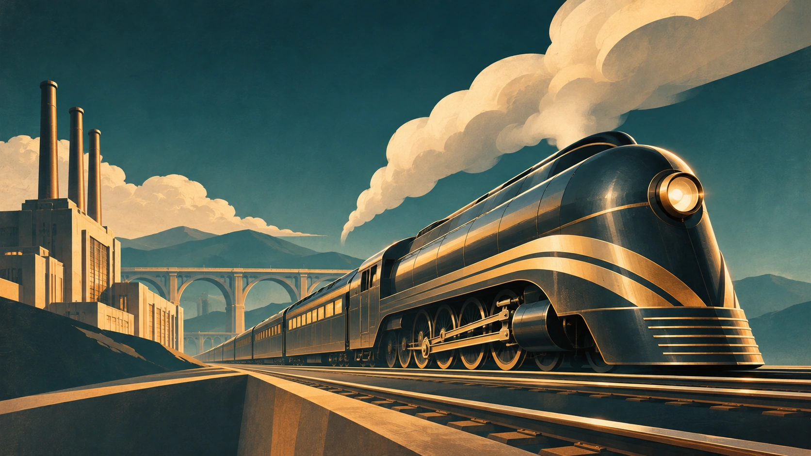
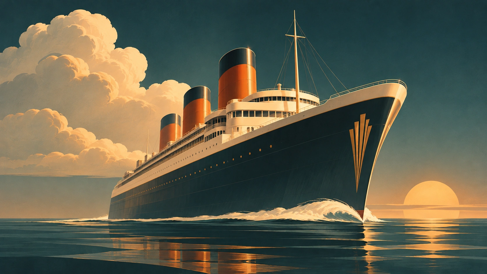
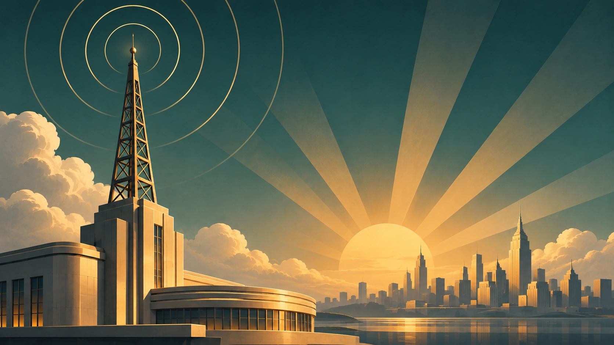
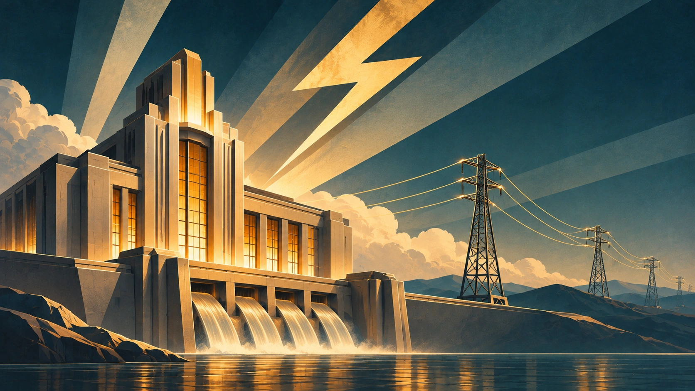
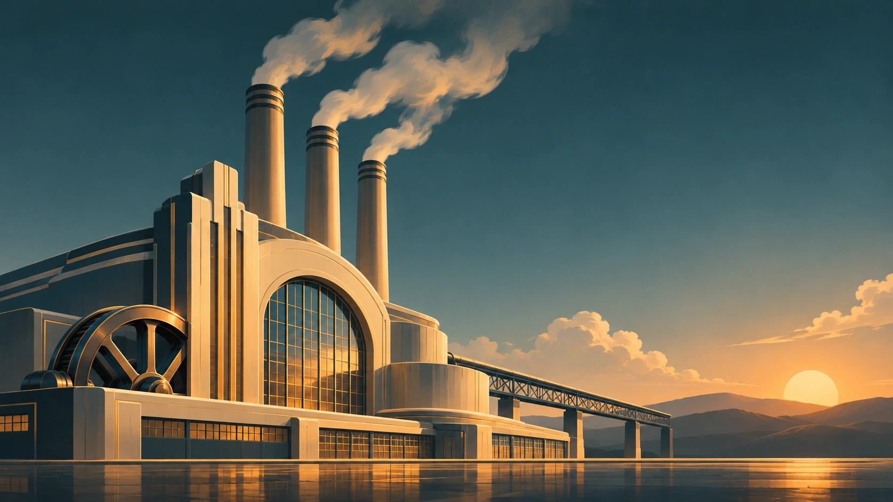
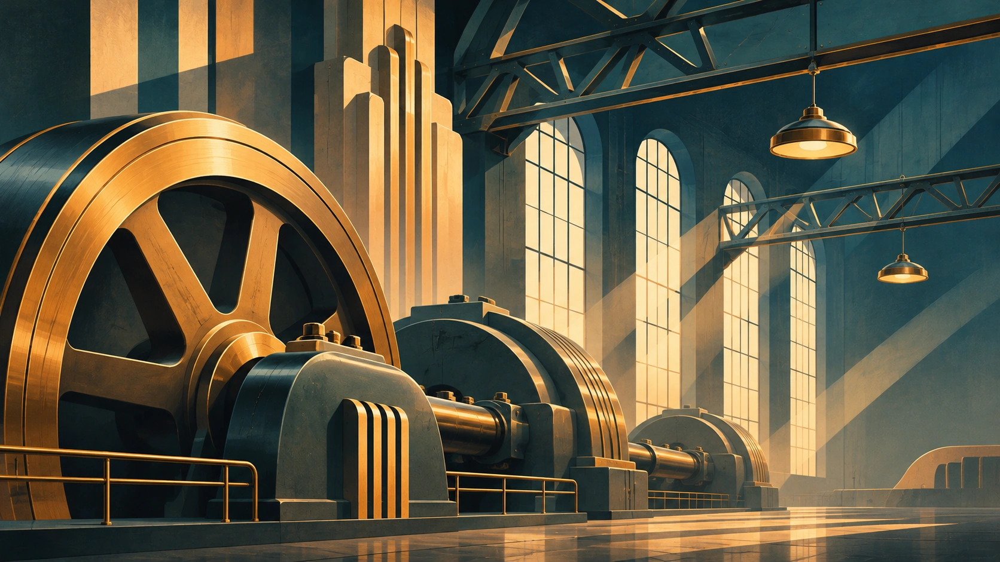
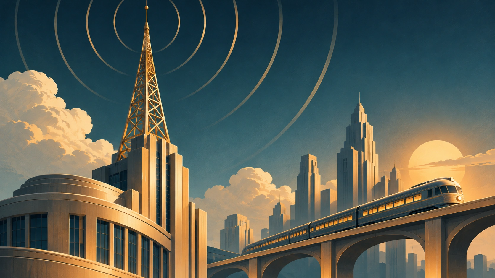

# Atlas Deco

An art deco theme for [Omarchy](https://omarchy.org), inspired by 1930s machine-age travel posters: a petrol-teal sky, gilded gold, molten copper and cream type.



## Install

```bash
omarchy theme install https://github.com/mass6/omarchy-atlas-deco-theme
omarchy theme set atlas-deco
```

You can also install it from the Omarchy menu under **Install › Style › Theme** by pasting the repository link.

Cycle through the wallpapers with `omarchy theme bg next`, or pick one with `omarchy theme bg-switcher`.

## Wallpapers

Nine wallpapers come with the theme.

<table>
  <tr>
    <td align="center"><a href="backgrounds/01-sunset-boulevard.webp"></a><br><sub>Sunset Boulevard</sub></td>
    <td align="center"><a href="backgrounds/02-dawn-of-flight.webp"></a><br><sub>Dawn of Flight</sub></td>
    <td align="center"><a href="backgrounds/03-streamlined-locomotive.webp"></a><br><sub>Streamlined Locomotive</sub></td>
  </tr>
  <tr>
    <td align="center"><a href="backgrounds/04-ocean-liner-at-sunset.webp"></a><br><sub>Ocean Liner at Sunset</sub></td>
    <td align="center"><a href="backgrounds/05-radio-tower-at-sunrise.webp"></a><br><sub>Radio Tower at Sunrise</sub></td>
    <td align="center"><a href="backgrounds/06-powerhouse-and-lightning.webp"></a><br><sub>Powerhouse and Lightning</sub></td>
  </tr>
  <tr>
    <td align="center"><a href="backgrounds/07-factory-at-golden-hour.webp"></a><br><sub>Factory at Golden Hour</sub></td>
    <td align="center"><a href="backgrounds/08-industrial-power-hall.webp"></a><br><sub>Industrial Power Hall</sub></td>
    <td align="center"><a href="backgrounds/09-broadcast-city.webp"></a><br><sub>Broadcast City</sub></td>
  </tr>
</table>

Click any wallpaper to open it at full size.

## Palette

| Role | Hex | From the art |
|------|-----|--------------|
| Background | `#121c21` | Night side of the sky |
| Selection | `#26404a` | Petrol-teal sky |
| Muted | `#62808a` | Distant hills and haze |
| Foreground | `#efe3c2` | Cream limestone |
| Accent | `#f2b52a` | Gilded sunrays |
| Orange | `#e8913a` | Low sun |
| Red | `#d9643a` | Ocean liner funnels |
| Green | `#9db88f` | Verdigris |
| Cyan | `#7fb3ab` | Sea light |
| Blue | `#7198b3` | High sky |
| Magenta | `#c88e9c` | Dusk clouds |

The active window border runs from gold to molten copper (`#cc6224`). Icons use Yaru-yellow.

Omarchy generates every terminal and app config from `colors.toml`, so the theme is just the palette, the icon setting and the wallpapers.

## License

[MIT](LICENSE)
